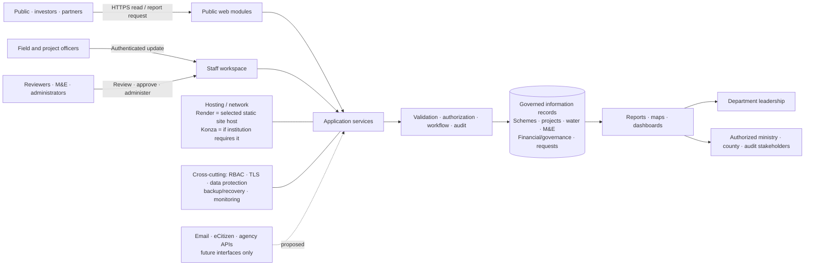

# NISIP-MIS Integrated Systems Design

## Original goal

The proposed National Irrigation Sector Investment Plan Management Information System (NISIP-MIS) aims to improve irrigation planning and accountability by organizing scheme, project, water-resource and performance information and making approved information available for monitoring and decisions.

## Integrated design

### How the parts cooperate

1. **People and process:** Public users browse approved information; officers submit assigned records; reviewers validate updates and report requests; leadership uses governed outputs.
2. **Applications and services:** The catalogue, project list, map, calculator and report request share an application boundary. A protected staff workspace separates internal writes/reviews from public reads.
3. **Events and data:** A submission event triggers validation, authorization, server timestamping and audit capture. Accepted information updates the appropriate logical register; approvals and request-status changes trigger reporting or notification actions.
4. **Interfaces and messaging:** Browser traffic uses HTTPS. Production should expose versioned, authorized APIs and structured request references. Email and other external integrations remain disabled until approved.
5. **Technology and operations:** Render is the selected ongoing host for the current static project site. The original BRS specified government hosting; using Render changes that requirement and should be approved if the BRS is binding. A real operational system additionally requires persistent data services, identity, backups, monitoring and support.
6. **Security:** Least-privilege access, data minimization, validation, auditability, encrypted transport, approved retention, protected backups and monitoring apply across components.

## Integration boundary

The original process diagram’s project database, financial records and scheme-performance store are logical information domains, not proof of deployed databases. Ministry, Treasury, county, Auditor-General, eCitizen, email and other organizations are not live integrations. There are no financial transactions, HR/IFMIS functions or automated sensor feeds. Progress is the latest sourced officer submission, not real-time telemetry.

## Hosting and current implementation

The supplied BRS states Konza/government infrastructure as the original production hosting requirement. The user has selected Render as the ongoing host for the current static project site. If the original government-hosting requirement is mandatory for assessment or institutional policy, obtain approval for the change or deploy the service through the approved government environment. This app has no authentication or database, so it must not be used for sensitive authoritative records.

The static prototype includes sample catalogue/project pages, a map, an indicative calculator, a report-request preview and an unconnected sign-in screen. It does not create accounts, transmit report requests, retain submissions, run a database or connect APIs. Sample data and calculations are illustrative, not official.

